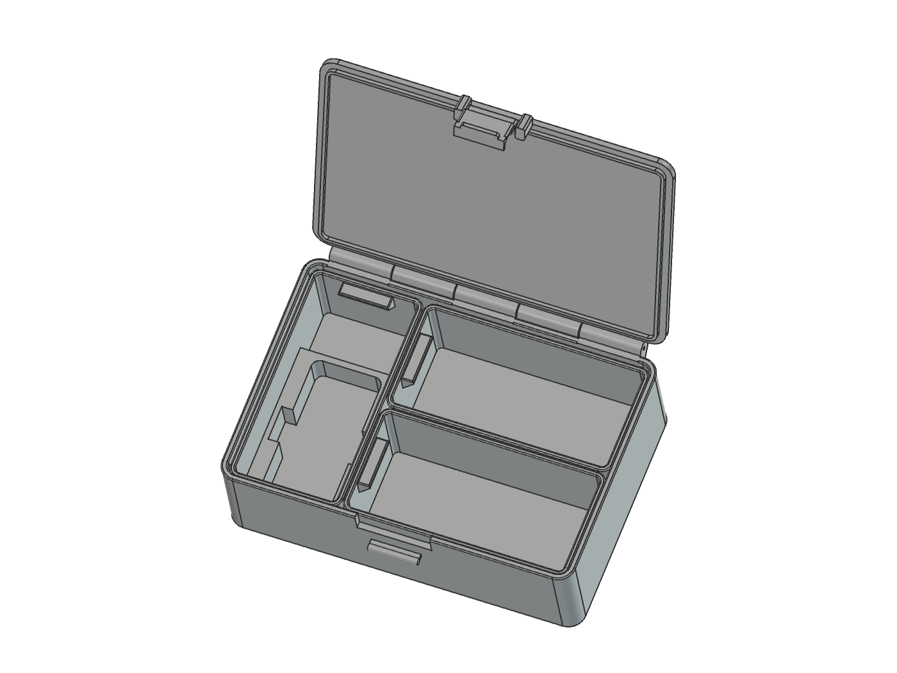

# org_box

Organizer PLA untuk **Bambu Lab A1 Mini**: 170 × 115,5 × 50 mm, tiga tray identik yang bisa ditukar, engsel filamen, snap-lock, dan stacking.



## STL

Semua file cetak ada di [`stl/`](stl/).

| Bagian | Link STL |
| --- | --- |
| Kotak | [Badan](stl/organizer_a1mini_base.stl) · [Tutup](stl/organizer_a1mini_lid.stl) · [Kait](stl/organizer_a1mini_latch.stl) |
| Tray | [Alat](stl/organizer_a1mini_tooltray.stl) · [Kabel 1](stl/organizer_a1mini_cabletrayfront.stl) · [Kabel 2](stl/organizer_a1mini_cabletrayback.stl) |
| Cable clip | [Clip dua jalur](stl/organizer_a1mini_cableclip.stl) |
| Test kunci | [Penahan](stl/test_snap_lock_base.stl) · [Poros](stl/test_snap_lock_lid.stl) · [Kait](stl/test_snap_lock_latch.stl) |

**Cetak test kunci dulu.** Awal: skala 100%, layer 0,2 mm, 5 perimeter, infill 25%. Cek support lokal di slicer. Pin engsel: filamen Ø1,75 mm. Slot alat nominal 32,6 × 70 mm; tebal sementara 15 mm.

> Prototipe belum diuji cetak fisik. Kunci dan stacking belum memiliki rating beban; jangan angkat kotak dari tutup/kait.

## Edit & panduan

- [`cad/`](cad/): generator model dan test kunci; output FCStd di root, STL di `stl/`.
- [`scripts/`](scripts/): render dokumentasi, terpisah dari generator.
- [Panduan cetak, perakitan, dan parameter](docs/GUIDE.md) · [Model FreeCAD](organizer_a1mini.FCStd)

```sh
python cad/organizer_a1mini.FCMacro --check
```

[MIT](LICENSE). Referensi prinsip snap-lock: [Kong 3D](https://makerworld.com/en/models/1766347-customizable-snap-lock-box-parametric); file dan gambar pihak ketiga tidak disertakan.
