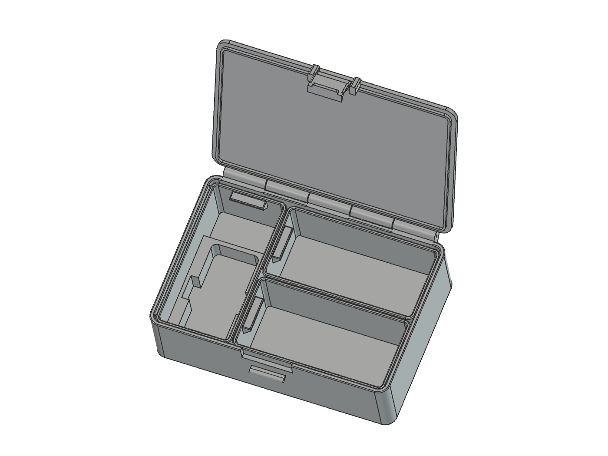

# org_box

Organizer PLA untuk **Bambu Lab A1 Mini**: 170 × 115,5 × 50 mm, tiga tray identik yang bisa ditukar, engsel filamen, snap-lock, dan stacking.



## STL

Semua file cetak ada di [Releases](../../releases/latest), dibangun otomatis oleh CI dari `build.FCMacro`.

| Bagian | File STL |
| --- | --- |
| Kotak | `organizer_a1mini_base` (badan) · `organizer_a1mini_lid` (tutup) · `organizer_a1mini_latch` (kait) |
| Tray | `organizer_a1mini_tooltray` (alat) · `organizer_a1mini_cabletrayfront` · `organizer_a1mini_cabletrayback` (kabel) |
| Cable clip | `organizer_a1mini_cableclip` (clip dua jalur) |
| Test kunci | `test_snap_lock_base` (penahan) · `test_snap_lock_lid` (poros) · `test_snap_lock_latch` (kait) |

**Cetak test kunci dulu.** Awal: skala 100%, layer 0,2 mm, 5 perimeter, infill 25%. Cek support lokal di slicer. Pin engsel: filamen Ø1,75 mm. Slot alat nominal 32,6 × 70 mm; tebal sementara 15 mm.

> Prototipe belum diuji cetak fisik. Kunci dan stacking belum memiliki rating beban; jangan angkat kotak dari tutup/kait.

## Edit & panduan

- [`build.FCMacro`](build.FCMacro): satu entry point; bangun semua part, lalu jalankan semua cek. Output ke `out/`.
- [`cad/`](cad/): generator model, test kunci, dan studi reverse snap-lock (di luar build produk).
- [`scripts/`](scripts/): render dokumentasi, terpisah dari generator.
- [Panduan cetak, perakitan, dan parameter](docs/GUIDE.md)

```sh
# Cek dimensi saja, tanpa FreeCAD.
python3 build.FCMacro --check

# Build penuh: out/*.stl dan out/*.FCStd, plus cek tabrakan, tray, stacking, kait.
flatpak run --command=FreeCADCmd org.freecad.FreeCAD "$PWD/build.FCMacro"
```

Push tag `v*` membuat release baru dengan semua STL dan FCStd.

[MIT](LICENSE). Referensi prinsip snap-lock: [Kong 3D](https://makerworld.com/en/models/1766347-customizable-snap-lock-box-parametric); file dan gambar pihak ketiga tidak disertakan.
