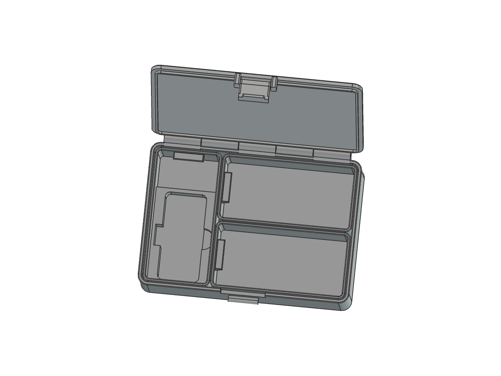
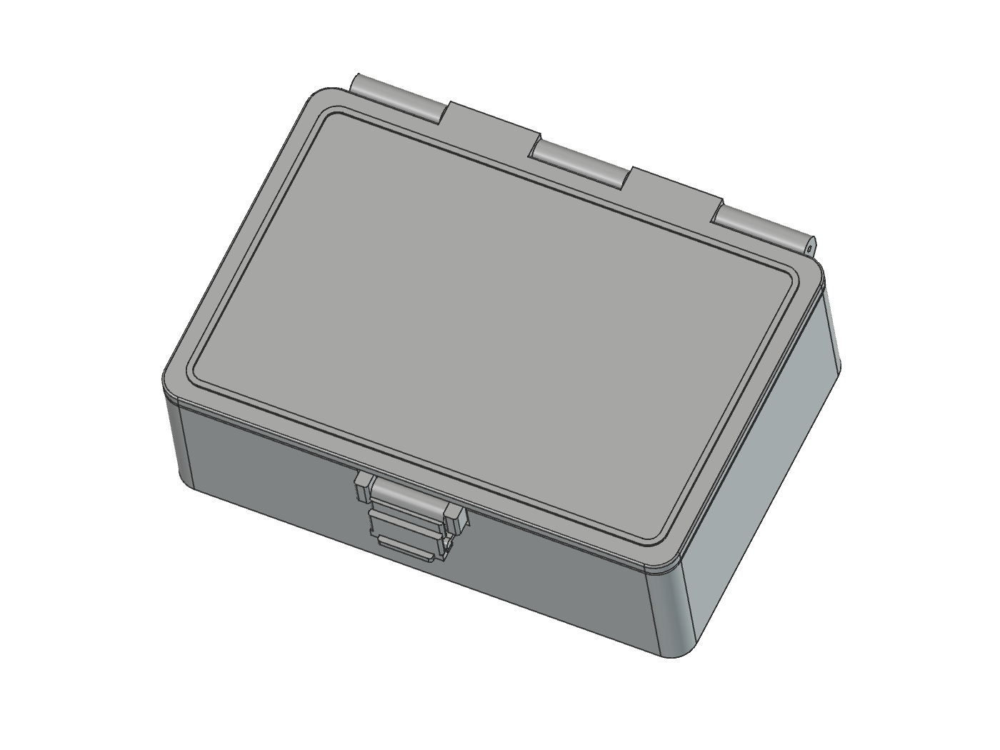

# org_box — Modular Bento Organizer

Organizer meja parametrik untuk Bambu Lab A1 Mini, dibuat di FreeCAD. Tiga tray memiliki dimensi luar sama dan dapat bertukar posisi dengan rotasi 90°. Desain ditujukan untuk PLA hitam; render abu-abu hanya untuk memperjelas bentuk.


> **Prototipe, belum tervalidasi lewat cetak fisik.** Pemeriksaan CAD bukan jaminan kekuatan atau keberhasilan cetak. Cetak test kunci terlebih dahulu.

## Fitur dan ukuran

| Bagian | Ukuran / detail |
| --- | --- |
| Badan | 170 × 115,5 × 50 mm, tidak termasuk tonjolan engsel/kunci |
| Tray | 3 buah, masing-masing 54 × 108,5 × 43 mm |
| Slot alat | Alat nominal 32,6 × 70 mm; kelonggaran 0,4 mm per sisi |
| Tebal alat | **Asumsi 15 mm**; ukur alat asli sebelum cetak |
| Engsel | 5 ruas sama panjang, 29,6 mm; celah 0,5 mm |
| Pin engsel | Potongan filamen Ø1,75 mm, panjang awal sekitar 153 mm |
| Pengunci | Snap-lock tengah, kait terpisah dipasang ke poros integral tutup |
| Stacking | Rib tutup 0,8 mm masuk ke alur bawah 1 mm; kelonggaran 0,35 mm/sisi |
| Finishing | Chamfer bawah 0,8 mm, fillet bibir 0,6 mm |
| Pegangan tray | Menjorok ke dalam, rusuk bawah 36,9° dari vertikal |
| Cable clip | Aksesori terpisah; dua jalur Ø5,4 mm untuk kabel nominal Ø5 mm |





## Download untuk cetak

Cetak STL berikut **pada skala 100%**. Unit mm. File FCStd adalah rakitan tertutup, bukan tata letak cetak. Gambar tutup terbuka dibuat terpisah oleh skrip dokumentasi.

| STL | Jumlah | Fungsi |
| --- | ---: | --- |
| [Badan](organizer_a1mini_base.stl) | 1 | Kulit luar dan dudukan kait |
| [Tutup](organizer_a1mini_lid.stl) | 1 | Tutup, engsel, poros kait, rib stacking |
| [Kait](organizer_a1mini_latch.stl) | 1 | Snap-lock |
| [Tray alat](organizer_a1mini_tooltray.stl) | 1 | Slot alat, relief konektor samping, ruang aksesori |
| [Tray kabel depan](organizer_a1mini_cabletrayfront.stl) | 1 | Tray kosong modular |
| [Tray kabel belakang](organizer_a1mini_cabletrayback.stl) | 1 | Tray kosong modular identik |
| [Cable clip](organizer_a1mini_cableclip.stl) | Sesuai kebutuhan | Dipasang ke dua ruas kabel dari samping |

### Test kunci dahulu

Cetak ketiganya, bukan hanya kait:

- [Sampel badan dan penahan](test_snap_lock_base.stl)
- [Sampel tutup dan poros](test_snap_lock_lid.stl)
- [Kait](test_snap_lock_latch.stl)

Sampel memakai geometri kunci produksi yang sama. Pegang dua potongan dinding sesuai rakitan tertutup untuk menguji kuncinya. Sampel ini bukan kotak berengsel mandiri dan bukan alat ukur kekuatan.

## Mulai cepat

1. Cetak test kunci memakai PLA dan pengaturan yang akan dipakai untuk kotak.
2. Periksa kecocokan, pelepasan, retensi, dan tanda retak; sesuaikan parameter jika perlu.
3. Cetak badan, tutup, kait, dan tray secara terpisah agar muat build plate A1 Mini 180 × 180 mm.
4. Rakit dengan pin filamen, pasang kait, lalu masukkan tray.

Pengaturan awal: nozzle 0,4 mm, layer 0,2 mm, 5 perimeter, infill 25%. **Jangan menganggap seluruh desain bebas support:** cek poros, engsel, alur bawah, dan rib stacking tutup pada preview slicer.

Lihat [panduan cetak, perakitan, pengujian, dan modifikasi](docs/GUIDE.md).

## Edit di FreeCAD

- [Makro utama](cad/organizer_a1mini.FCMacro): parameter berada di awal file. Jalankan lewat **Macro → Macros → Execute**.
- [Makro test kunci](cad/test_snap_lock.FCMacro): jalankan setelah model utama dibuat/disimpan.
- [Skrip render dokumentasi](scripts/render_docs.FCMacro): jalankan di GUI setelah generator. Tidak mengubah file CAD.
- [Model organizer](organizer_a1mini.FCStd)
- [Model cable clip terpisah](cable_clipper.FCStd)
- [Model test kunci](test_snap_lock.FCStd)

`cad/` hanya membentuk, memvalidasi, dan mengekspor geometri. `scripts/` untuk dokumentasi; `docs/` berisi panduan dan render. Setiap eksekusi generator membuat dokumen baru dan menimpa output FCStd/STL di **root proyek**. Simpan perubahan manual ke nama lain sebelum menjalankan ulang.

Cek dimensi tanpa FreeCAD:

```sh
python cad/organizer_a1mini.FCMacro --check
```

Pembuatan dan pengecekan solid memerlukan FreeCAD dengan modul Part, Sketcher, dan MeshPart. Dibangun dan diuji pada FreeCAD 1.1; versi lain belum diverifikasi. Tidak memerlukan paket Python eksternal.

## Batas desain

- Bukan kotak kedap air, bukan food container, dan bukan pengunci keamanan.
- Snap PLA, toleransi pin, serta stacking belum diuji fisik. Jangan mengangkat kotak melalui kait atau tutup.
- Jauhkan PLA dari panas dan matahari langsung. Gunakan rentang temperatur cetak dari produsen filamen.
- Stacking menahan geser, bukan mengikat kotak. Tidak ada rating beban atau tinggi tumpukan.
- Tidak ada sambungan M3 pada versi ini. Pemisahan badan dengan insert/sekrup baru diperlukan jika ukuran melampaui build plate.

## Lisensi dan referensi

Kode, desain CAD buatan proyek ini, STL hasilnya, dan render di repository ini dilisensikan [MIT](LICENSE).

Prinsip snap-lock dipelajari dari [Customizable Snap-Lock Box oleh Kong 3D](https://makerworld.com/en/models/1766347-customizable-snap-lock-box-parametric). Geometri proyek ini dibuat sendiri lewat sketch dan fitur FreeCAD; file CAD, mesh, serta gambar model tersebut tidak disertakan. Lisensi MIT proyek ini tidak berlaku untuk materi pihak ketiga.
